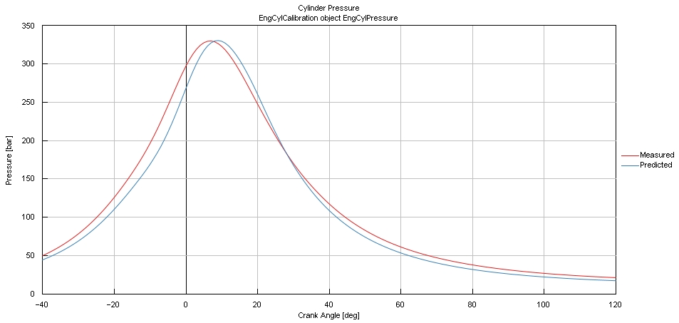

# Ranjan Pattnaik — Powertrain & Motorsport Engineering Portfolio

**MSc Racing Engine Systems · Oxford Brookes University (2024–2025)**

I work on the simulation side of powertrain engineering: 1D engine and vehicle models in GT-Suite, structural and fatigue analysis in Ansys, electric-drive and thermal models in Multisim and OpenModelica, and data-driven calibration with design of experiments and machine learning. This repository collects my postgraduate projects, written up as short engineering case studies with the key figures and results.

> 🌐 **Portfolio website:** https://ranjanpattnaik.github.io/ranjanpattnaik_portfolio/
>
> 📫 **Contact:** [LinkedIn](https://www.linkedin.com/in/YOUR-PROFILE) · [Email](mailto:YOUR-EMAIL) · CV on request

---

## Featured project

### [ML-based combustion control & knock prediction for an ethanol-fuelled 2026 F1 power unit](projects/01-f1-2026-ml-combustion-knock/) — MSc dissertation

- Built and calibrated a single-cylinder GT-Suite model of an FIA 2026-compliant 1.6 L V6 cylinder running **E20** at **10,500 rpm** (IMEP 28.0 bar, peak pressure ≈ 335 bar, trapped mass 1.13 g/cycle)
- Ran a **900-case Latin Hypercube DoE** over AFR, spark timing, intake-valve closing and turbulence multiplier
- Trained linear, neural-network and **Gaussian Process Regression** surrogates; GPR reached **R² > 0.95** on all outputs and predicted in under a second per case
- Used the surrogate to locate a **knock-safe spark-advance window** while holding target IMEP

 

---

## Projects

| # | Project | Area | Tools | Headline result |
|---|---------|------|-------|-----------------|
| 01 | [ML combustion control & knock prediction, 2026 F1 PU](projects/01-f1-2026-ml-combustion-knock/) | Combustion · ML | GT-Suite, GT Data Mining Toolkit | GPR surrogate R² > 0.95; knock-safe spark window identified |
| 02 | [Real-world drive cycle & hybrid powertrain modelling](projects/02-hybrid-powertrain-drive-cycle-gt-drive/) | Vehicle energy · HEV | GT-Drive | Oxford real-world cycle used 9.7 vs 9.0 L/100 km on NEDC; HEV control behaviour analysed |
| 03 | [2026 F1 turbocharger at high altitude (Mexico GP)](projects/03-f1-2026-turbocharger-altitude/) | Boosting · Regulations | GT-Power | Boost 5.1 bar sea level (over 4.8 bar limit, wastegate needed) vs 4.1 bar at 2,200 m |
| 04 | [Three-stage variable intake manifold, BMW inline-six](projects/04-variable-intake-manifold-inline-six/) | Gas dynamics | GT-Power, Python | Flap switching moves peak VE from 4,250 to 5,500 rpm; 96.5 % peak VE |
| 05 | [Cylinder-pressure combustion analysis & pressure reconstruction](projects/05-cylinder-pressure-combustion-analysis/) | Combustion diagnostics | Excel, MATLAB | MFB / heat release from 1.6 L GDI data; speed-based pressure reconstruction re-implemented |
| 06 | [Formula E Gen3-class electric powertrain design](projects/06-formula-e-electric-powertrain-design/) | E-drive · HV battery | Multisim, Python | 243s12p 900 V / 50 kWh pack, IGBT inverter, regen circuit |
| 07 | [Lumped-parameter thermal model of a hybrid traction motor](projects/07-ev-motor-lumped-parameter-thermal-model/) | Thermal management | OpenModelica | End-winding temperature at 1,000 s cut from ≈169 °C to ≈92 °C with ATF cooling |
| 08 | [Random-load fatigue of a desmodromic rocker arm](projects/08-desmodromic-rocker-arm-random-fatigue/) | Structures · Fatigue | Ansys, MATLAB | 31 MPa peak stress, FoS 7.6; time- and frequency-domain fatigue |
| 09 | [Fatigue lab: S-N prediction vs test](projects/09-fatigue-lab-sn-life-prediction/) | Materials testing | UTM, Python | Predicted 10⁵-cycle loads within 1–9 % of test loads; plain-beam prediction proved conservative |

---

## Skills

| Area | What I've used it for |
|------|----------------------|
| **1D engine & vehicle simulation** | GT-Power (intake tuning, turbo matching, combustion calibration), GT-Drive (drive cycles, conventional and power-split hybrid vehicles) |
| **Combustion analysis** | Cylinder-pressure analysis, mass fraction burned (Rassweiler–Withrow, Wiebe), first-law heat release, knock index and knock onset |
| **Data-driven calibration** | Design of experiments (Latin Hypercube), Gaussian Process / Kriging, neural-network and linear surrogates, Morris sensitivity, RMSE / R² validation |
| **Boosting** | Compressor and turbine map interpretation, surge/choke margins, altitude derating, FIA 2026 PU turbo rules |
| **Electric powertrain** | Battery pack sizing, IGBT vs MOSFET vs SiC selection, three-phase inverter and regenerative braking circuits (Multisim) |
| **Thermal management** | Lumped-parameter thermal networks (OpenModelica), motor cooling strategies, IEC 60034-6 / IEC 60085 |
| **Structures & fatigue** | Ansys static and fatigue analysis, mesh refinement, rainflow counting, PSD / spectral fatigue, S-N curves with Marin factors and Goodman correction, physical fatigue testing |
| **Programming & data** | Python (NumPy, pandas, Matplotlib), MATLAB, Excel |
| **Regulations & standards** | FIA 2026 F1 Power Unit Technical & Sporting Regulations, Formula E / LMDh electric-drive rules, ISO 26262 awareness |

---

## Timeline

| When | What |
|------|------|
| Jan–May 2024 (Sem 2, 2023–24) | GT-Power intake tuning (04), GT-Drive hybrid modelling (02), turbocharger design study (03), fatigue lab and group fatigue project (08, 09) |
| Sep–Dec 2024 (Sem 1, 2024–25) | Advanced combustion analysis (05), electric powertrain design (06) and thermal modelling (07) |
| June 2025 | MSc dissertation: ML combustion control for 2026 F1 PU (01) |

---

## Also in this portfolio

- **Work experience** and **courses & certifications**: *coming soon*. These are added through `content.js` (see [HOW-TO-EDIT.md](HOW-TO-EDIT.md)).

---

### About these write-ups

Each project folder has a case-study README with the problem, my approach, results, limitations and what I'd do next. They summarise university coursework from the Oxford Brookes MSc Racing Engine Systems programme. Full reports and simulation models are available on request rather than published, so that assessed work isn't redistributed. Figures are my own simulation outputs; third-party figures from the original reports are not reproduced here.

---

### Website & editing

- **Live site:** https://ranjanpattnaik.github.io/ranjanpattnaik_portfolio/
- `index.html` is the page layout. **All content (projects, experience, courses, education, contact) lives in [`content.js`](content.js)**, so adding work never means touching the layout.
- Step-by-step instructions with copy-paste templates: **[HOW-TO-EDIT.md](HOW-TO-EDIT.md)**
- Figures for both the website and the READMEs live in `projects/<folder>/images/`.
- Hosted with GitHub Pages from the `main` branch root (Settings → Pages).
