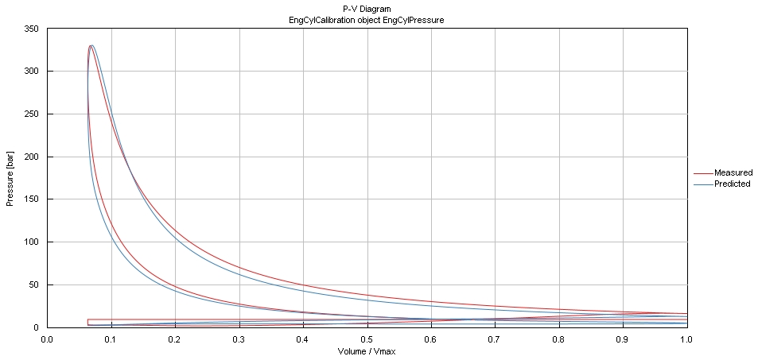
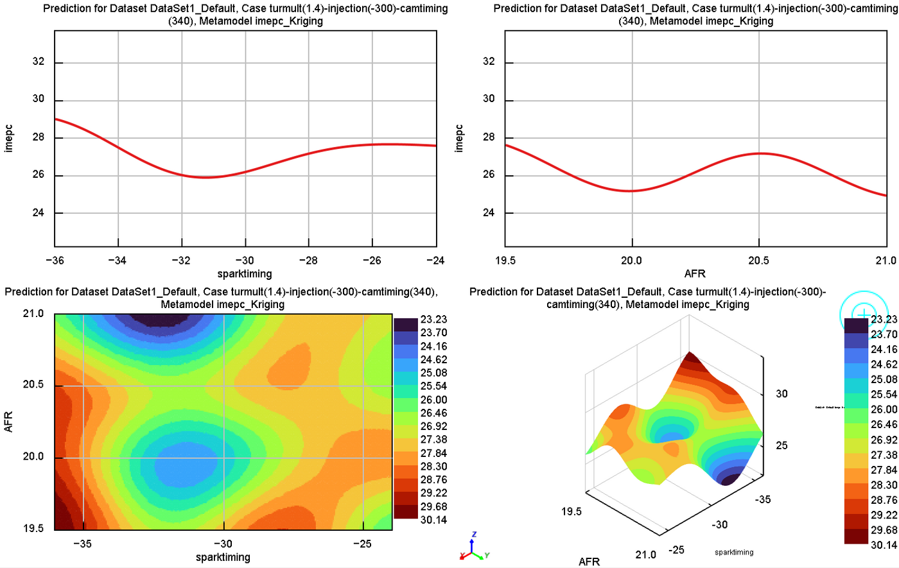
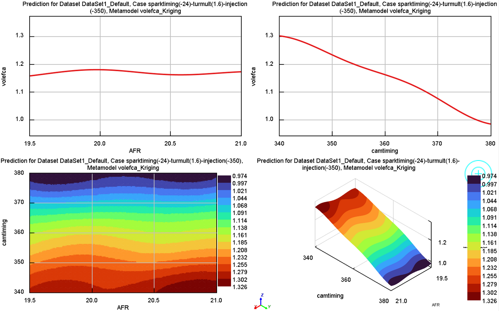
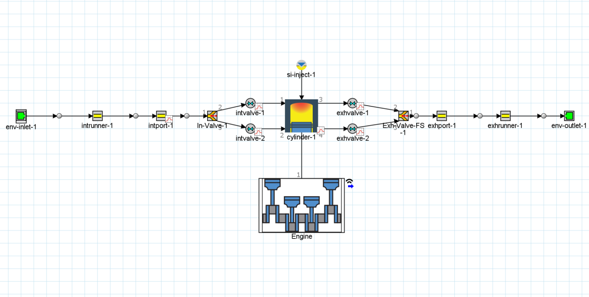

# Machine-learning combustion control & knock prediction for an ethanol-fuelled 2026 F1 power unit

**MSc dissertation (ENGR7019) · Oxford Brookes University · June 2025 · Individual**
**Tools:** GT-Suite (GT-Power, Data Mining Toolkit) · Latin Hypercube DoE · Gaussian Process Regression / Kriging · neural networks

---

## The problem

The FIA 2026 F1 power-unit regulations keep the 1.6 L turbocharged V6 but move to 100 % sustainable fuel, remove the MGU-H and push towards a 50/50 ICE/electric power split. Ethanol-containing fuels burn faster and resist knock better than gasoline, but calibrating spark timing, mixture and valve timing for a new fuel at 10,000+ rpm is expensive if every point needs a full 1D simulation or a dyno test.

**Question:** can a physics-based engine model plus a machine-learning surrogate map combustion and knock behaviour quickly enough to find a safe, high-output calibration window?

## Approach

```
GT-Suite single-cylinder model  →  Latin Hypercube DoE (900 cases)  →  ML surrogates (Linear / NN / GPR)  →  Optimisation sweeps
   E20, 10,500 rpm                  AFR · spark · IVC · turbulence       80/20 train-test, RMSE & R²          knock-safe window
```

1. **Engine model.** I built a single-cylinder GT-Suite model representing one cylinder of the 2026 1.6 L V6, with a pressure boundary replacing the turbocharger (boost set to match reference trapped mass and IMEP). Combustion used GT's turbulent flame-speed model with E20 properties from the Kinetics-Fit gasoline–ethanol database. Output resolution was 0.1° CA to capture the fast pressure rise. No EGR, in line with the regulations.
2. **Calibration and validation.** I calibrated against published 2026 F1 E20 data (Fuss & Samuel, 2025) by tuning AFR, spark timing, intake temperature and the flame-speed multiplier.
3. **Design of experiments.** Four inputs at seven levels each (2,401 possible combinations), sampled with Latin Hypercube to give 900 simulated cases:

   | Input | Range |
   |---|---|
   | Air–fuel ratio | 19.5 – 21.0 |
   | Spark timing | −34 to −28° CA |
   | Intake valve closing | −379 to −364° CA |
   | Turbulent flame multiplier | 1.4 – 1.8 |

   Outputs: IMEP, peak cylinder pressure, combustion duration (10–90 % MFB), knock index, volumetric efficiency and thermal efficiency.
4. **Surrogates.** I trained linear regression, neural-network and Gaussian Process Regression models in GT's Data Mining Toolkit (80 % train / 20 % test, normalised inputs, grid-searched hyper-parameters) and compared them on RMSE and R².
5. **Heat release and knock.** First-law apparent heat release, dQ/dθ = γ/(γ−1)·p·dV/dθ + 1/(γ−1)·V·dp/dθ, plus GT's knock-index model (induction-time integral) to track knock onset and unburned mass fraction.

## Results

**Validated baseline:** IMEP 28.02 bar · peak pressure ≈ 335 bar at ≈ 11° ATDC · trapped mass 1.13 g/cycle · CA50 ≈ 10° ATDC.

| Predicted vs measured cylinder pressure | Predicted vs measured P–V diagram |
|---|---|
|  |  |

**Surrogate performance:** GPR was the best model, with **R² > 0.95 on all five outputs**, strongest on IMEP and combustion duration. Linear regression could not capture the non-linear AFR response, and the neural network needed more tuning to match GPR. The GPR surrogate predicts a case in **under one second**, which made dense sweeps practical.


*IMEP response to spark timing and AFR from the Kriging surrogate.*

**What drives what** (main effects, scatter and Morris sensitivity):

| Input | Strongest effect |
|---|---|
| Spark timing | Knock index (advance ↑ IMEP but ↑ knock) |
| Turbulence multiplier | Burn duration (higher turbulence → shorter burn, peak pressure closer to TDC) |
| Intake valve closing | Volumetric efficiency (later IVC beyond ~370° CA → lower VE and trapped mass) |
| AFR | IMEP (non-linear; leaner than ~20.5 slows the burn but lowers knock tendency) |



**Knock window:** knock onset sat between −15° and −12° CA with unburned mass fraction ≈ 0.998 at onset. Optimisation sweeps on the GPR surrogate showed that spark could be advanced to about **−30° CA without knock** when paired with a slightly richer AFR and higher turbulence, while holding IMEP near the 27 bar target.



## Limitations

- Single cylinder, so no cylinder-to-cylinder variation or crank dynamics
- Fixed intake pressure boundary instead of a full turbo model, so no turbo lag or compressor-efficiency effects
- Steady state at 10,500 rpm only, with no transients, gear shifts or part load
- Default knock model, not re-tuned with new chemical-kinetics data
- Surrogates are only valid inside the DoE ranges

## Next steps

- Extend to transient and part-load operation, and add a full compressor–turbine model for boost-limited running
- Close the loop: use the surrogate in a real-time spark-advance controller driven by predicted knock
- Connect simulation outputs to a telemetry tool such as ATLAS for trackside calibration
- Add a chemistry-based knock model to test sensitivity to ethanol content and octane

## Skills demonstrated

1D combustion modelling · model calibration and validation · DoE · Gaussian Process / Kriging surrogates · sensitivity analysis · heat-release and knock analysis · FIA 2026 PU regulations
