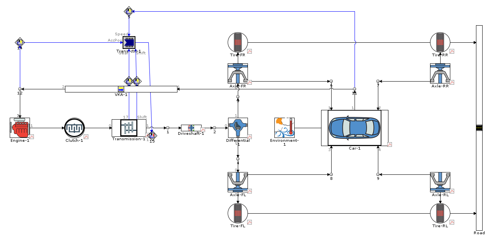
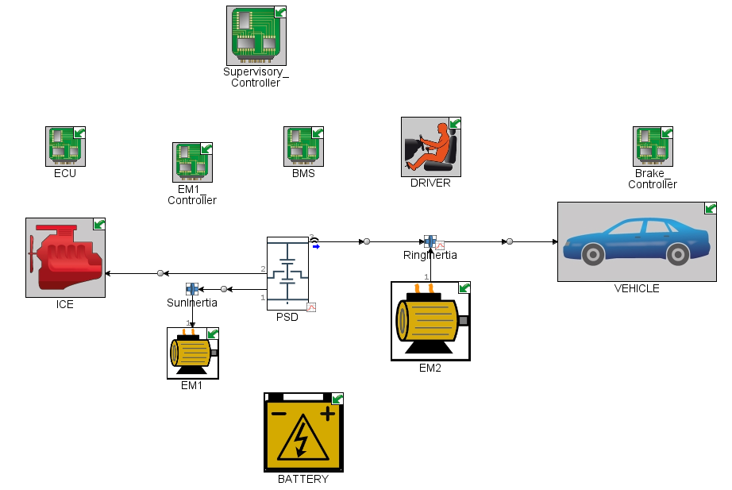
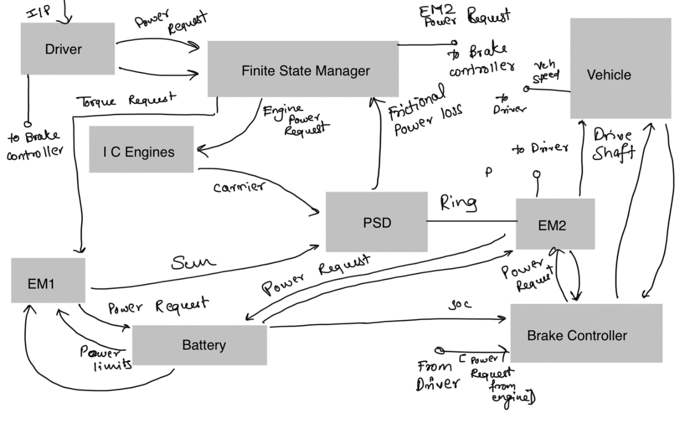
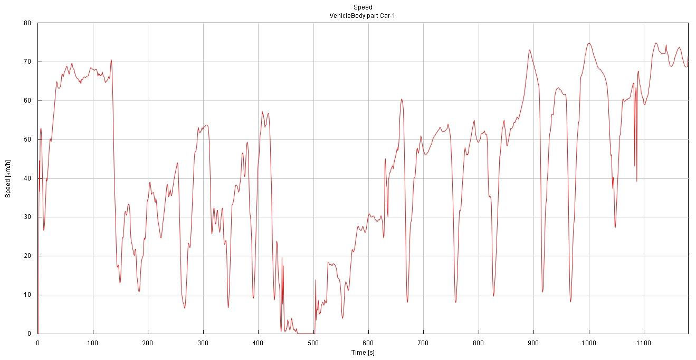
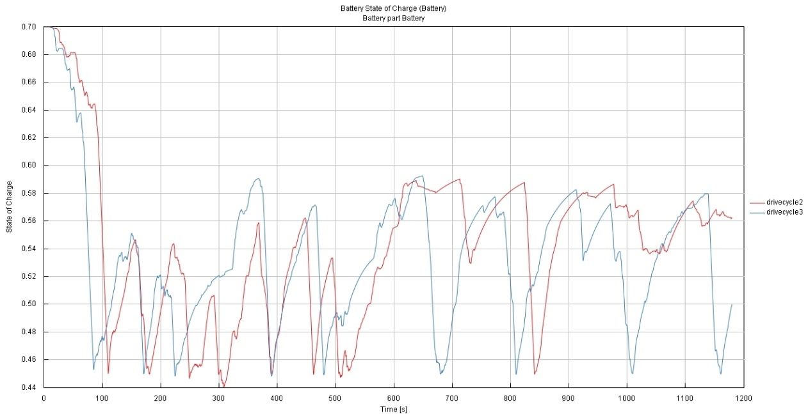
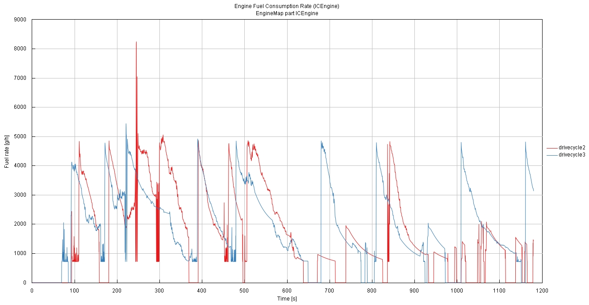

# Real-world drive cycle development & hybrid powertrain modelling

**ENGR7005 Advanced Powertrain Engineering · Oxford Brookes University · Spring 2024 · Individual modelling (drive-cycle data collected as a group)**
**Tools:** GT-Drive / GT-Suite · GT-Post

---

## The problem

Legislative cycles such as NEDC are smooth and stylised, so they under-represent the fuel use and emissions of real driving. The brief had two parts:

1. Build a real-world drive cycle (≥ 12 km over A roads, B roads and motorway), run it through a vehicle model, compare it with legislative cycles, and find the parameter that most affects fuel use on the route.
2. Take over a "handed-over" power-split hybrid model as a new R&D engineer: check its integrity, document how it works, and compare its fuel economy on legislative cycles and the real-world UK cycle.

## Approach

**Part 1 — conventional vehicle**
- Real-world speed–time data from a route around Oxford covering urban roads, A/B roads and the ring road
- GT-Drive backward-kinematic model (target speed drives the energy demand at each step) using VW Lupo engine maps: BMEP, fuel flow and emissions. I derived the air-flow map from fuel flow with a stoichiometric AFR of 14.7.
- Vehicle mass, drag coefficient and frontal area set for the Lupo, then run on the developed cycle, NEDC and WLTC

**Part 2 — power-split hybrid**
- Toyota Prius-type series–parallel HEV template: ICE and generator joined by a planetary gear set, two motor-generators, battery and supervisory controller
- Engine maps benchmarked against published in-situ Prius engine mapping (Duoba et al., SAE 2000-01-3096)
- I mapped the control logic: tractive power demand, battery SOC window, vehicle and engine speed for mode selection, motor power limits, and regen vs friction braking split
- Ran NEDC and the Oxford cycle under two driver-aggressiveness settings

| GT-Drive power-split HEV model | My control-architecture sketch |
|---|---|
|  |  |

## Results

**Conventional vehicle (VW Lupo model)**

| Metric | Oxford real-world cycle | NEDC |
|---|---|---|
| Distance | 12.1 km | 11.0 km |
| Average / max speed | 36.9 / 93 km/h | 33.6 / 120 km/h |
| Max acceleration | 3.89 m/s² | 1.04 m/s² |
| Fuel consumption | **9.7 L/100 km** (72.4 g/km) | **9.0 L/100 km** (67.4 g/km) |
| Share of fuel used accelerating | 38.5 % | 35.3 % |

The real-world cycle used about **8 % more fuel** than NEDC despite a lower top speed, because it is far more transient: its peak acceleration is almost four times the NEDC value. Further runs showed that **earlier upshifts at lower engine speed** were the most effective way to cut fuel use and CO₂ on this route.

**Power-split hybrid**

| Cycle | Fuel consumption |
|---|---|
| Oxford cycle, two driver settings | 6.5 – 7.0 L/100 km |
| NEDC | 4.7 L/100 km |

The battery SOC trace shows the control strategy at work. The motor drives the car from rest, the engine starts above a preset speed and shuts off at stops, and regenerative braking recharges the battery. High-speed sections pull SOC down sharply, which is where the hybrid loses its advantage over NEDC.

| SOC: aggressive vs intermediate driving | Fuel rate: aggressive vs intermediate |
|---|---|
|  |  |

## Limitations & next steps

- Backward-kinematic modelling assumes the vehicle follows the trace exactly, so a forward (driver-model) run would capture drivability limits
- Only one real-world route and vehicle were tested; multiple drives would let the cycle be statistically representative
- Next: optimise the HEV SOC window and engine-on threshold for the UK cycle, and quantify start-stop and regen contributions separately

## Skills demonstrated

Drive-cycle development · GT-Drive conventional and hybrid vehicle modelling · fuel-economy and CO₂ analysis · HEV control strategy · model integrity checking and documentation
