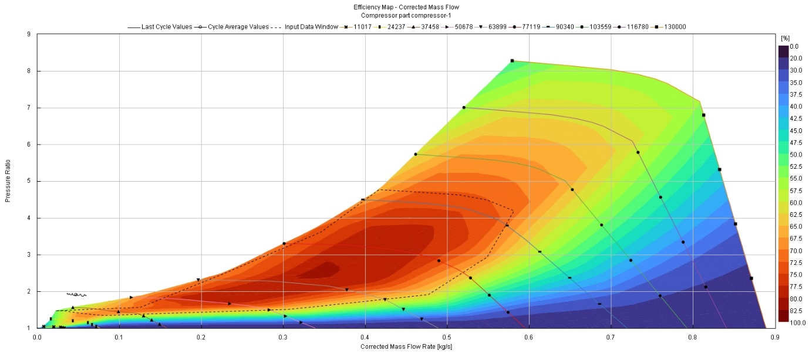

# Turbocharger design & analysis for a 2026 F1 power unit at altitude (Mexico City GP)

**ENGR7030 Racing Engine Systems – System Integration, Coursework 2 · Oxford Brookes University · Spring 2024 · Individual**
**Tools:** GT-Power · supplier compressor/turbine maps · FIA 2026 PU Technical Regulations

---

## The problem

The Autódromo Hermanos Rodríguez sits at about **2,200 m**, where air density is about 22 % lower than at sea level. With the MGU-H removed for 2026, the turbocharger has to recover that lost air mass on its own, within tight FIA dimensional, speed and boost limits.

## Regulations that set the design space (FIA 2026 PU Technical Regulations)

| Article | Requirement |
|---|---|
| 5.5.1 | Single-stage compressor and single exhaust turbine; no energy transfer from the rotating parts to other systems |
| 5.5.2 | Inlet pressure **≤ 4.8 bar(A)**, measured by an FIA sensor |
| 5.5.4 | Turbocharger mass ≥ 12 kg |
| 5.5.5 | Compressor exducer Ø 100–110 mm · turbine inducer Ø 90–100 mm · ≤ 175 mm between them, which ends the split-turbo layout |
| 5.5.6 | Shaft speed ≤ 150,000 rpm |
| 5.9 | Wastegate only; variable-geometry and variable-nozzle turbines banned |
| 15.9 | Material rules: Fe/Ni alloys in the exhaust path, Al-alloy compressor wheel, turbine housing must contain wheel-burst debris |

## Approach

- Updated a 1.6 L V6 GT-Power model (after Reeves & Samuel, SAE 2023-01-0739) to 2026 rules: 80 mm bore, CR ≤ 16, 3,000 MJ/h fuel energy-flow limit
- Imported measured compressor and turbine maps for a BorgWarner EFR 9180-class unit (single-scroll, ~1,000 hp capacity)
- Left the wastegate **out on purpose** to see the unregulated boost the turbo would produce
- Swept engine speed from 4,000 to 10,500 rpm at standard ambient conditions, then repeated with Mexico City ambient pressure and density

## Results

*Compressor operating points on the efficiency map, away from surge and choke, with peak map efficiency around 80 %.*

| Turbo operating point (GT-Post) | Sea-level ambient | Mexico City (2,200 m) |
|---|---|---|
| Shaft speed | 92,950 rpm | 93,380 rpm |
| Compressor pressure ratio | 4.70 | 4.92 |
| Compressor inlet → outlet pressure | 0.96 → 4.64 bar | 0.73 → 3.70 bar |
| Air mass flow | 0.38 kg/s | 0.31 kg/s (−18 %) |
| Compressor power / efficiency | 91.3 kW / 68.9 % | 75.2 kW / 67.8 % |
| Turbine inlet temperature | 1,007 K | 991 K |

- **At sea level the boost overshoots the rules.** Without a wastegate, inlet pressure reaches **5.1 bar at 10,500 rpm**, above the 4.8 bar limit, so a wastegate is required for compliance.
- **At altitude the problem flips.** Even with a higher pressure ratio the turbo can't make up for the thin inlet air: boost falls to **4.1 bar at 10,500 rpm** and mass flow drops by 18 %, with a clear loss of engine power and torque.
- Shaft speed stays far below the 150,000 rpm limit in both cases, so there is room to run the turbo harder at Mexico.
- GT-Post flagged the compressor pressure ratio slightly beyond the supplied map (×1.07 / ×1.05), so these points are extrapolated.

## Evaluation

- The same hardware needs **opposite wastegate strategies**: bleed boost at sea-level circuits, keep the wastegate shut and use the shaft-speed margin at Mexico.
- The steady-state model leaves out heat transfer and pulsating flow, and running beyond the supplied map means wider-range map data is needed before trusting the altitude numbers.
- I also reviewed control-oriented turbo models for real-time ECU use, variable-geometry turbines (not allowed in F1 but common on road cars), downsizing trends, and failure modes: thrust-bearing lubrication, compressor deposits and over-temperature.

## Next steps

Add the pneumatic wastegate with a boost-target controller, run transient lap simulations, and size the compressor to balance the 4.8 bar sea-level cap against altitude margin.

## Skills demonstrated

Turbocharger matching · compressor and turbine map interpretation · altitude derating · regulation-driven design · GT-Power system modelling
