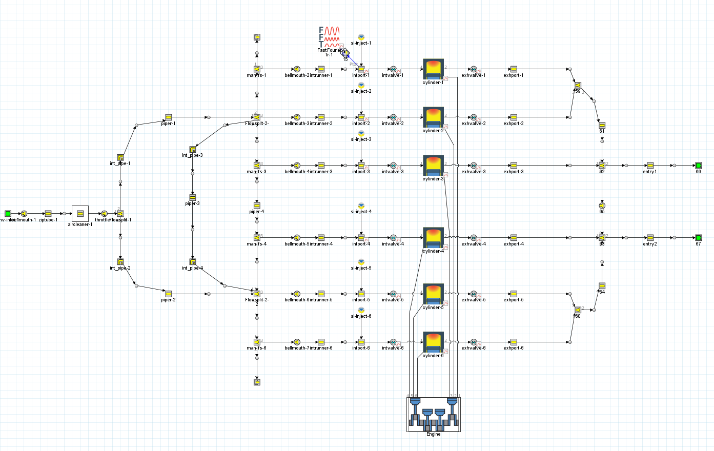
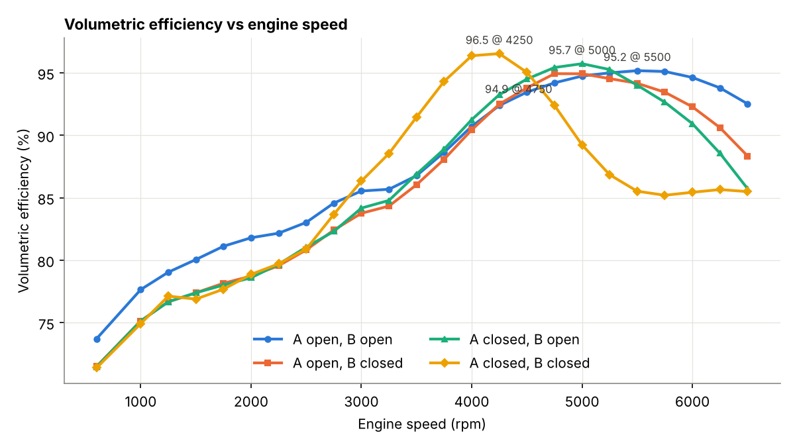
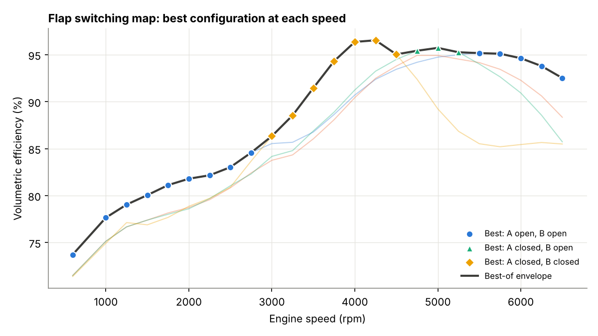

# Three-stage variable intake manifold for a BMW inline-six

**ENGR7030 Racing Engine Systems – System Integration, Coursework 1 · Oxford Brookes University · Spring 2024 · Individual**
**Tools:** GT-Power / GT-Post · hand measurement of a physical manifold · Python (post-processing)

---

## The problem

A naturally aspirated engine can only burn the air it traps. Tuned intake runners and resonance plenums use pressure waves to push extra charge into the cylinder, but each geometry is only tuned for one speed band. BMW's three-stage resonance manifold uses two flaps to switch effective runner and plenum volumes. The brief was to model a BMW M52-type 6-cylinder SI engine with this manifold and find what drives its volumetric efficiency (VE).

**Engine:** inline-6, 84 mm bore, CR 10.0, DOHC 4-valve, 240°/244° cam durations, sequential port injection.

## Approach

1. **Measured the real manifold** from the thermodynamics lab: runner lengths and diameters, resonance-pipe geometry, and total volume (≈ 7.1 L)
2. **Built the 1D model in GT-Power.** Three flow-splits represent the resonance pipes. I filled in each boundary's X/Y/Z angles so the 1D network keeps the 3D layout, then connected six runners to the intake ports.
3. **Ran a speed sweep** from 600 to 6,500 rpm (250 rpm steps, 10 cycles per case) for the four flap states: A/B open/closed
4. **Post-processed** VE, torque and an FFT of intake-port pressure. I've exported the results to CSV here and re-plotted them with a script in this folder.



## Results



| Flap state | Peak VE | at | Peak torque | at |
|---|---|---|---|---|
| A open, B open | 95.2 % | 5,500 rpm | 258 N·m | 4,500 rpm |
| A open, B closed | 94.9 % | 4,750 rpm | 257 N·m | 4,750 rpm |
| A closed, B open | 95.7 % | 5,000 rpm | 259 N·m | 4,500 rpm |
| A closed, B closed | **96.5 %** | **4,250 rpm** | **269 N·m** | **4,000 rpm** |

- Closing both flaps (longest effective path) gives the highest VE and torque but tunes the system to **4,250 rpm**; above ~4,500 rpm VE collapses to about 85 %.
- Opening both flaps tunes for **5,500 rpm** and holds VE above 92 % to the 6,500 rpm limit.
- The intake-port pressure FFT is dominated by the **1.5 engine order** in every configuration, and its amplitude is largest (≈ 2× the open case) with both flaps closed, which matches that configuration's resonance gain.

**Switching map (post-processing of the same results).** Picking the best flap state at each speed gives the envelope below: both-open up to ~2,750 rpm, both-closed from 3,000 to 4,500 rpm, A-closed/B-open from 4,750 to 5,250 rpm, then both-open again. With switching, VE stays above 93.8 % all the way from 3,750 to 6,250 rpm, where no single flap state manages that on its own.



The trends agree with BMW's published development work (Otto et al., *Proc. IMechE Part D*, 2000), where the resonance flap gives a flatter torque curve and higher peak power than a fixed manifold.

## Reproduce the plots

```bash
cd scripts
python plot_intake_results.py      # needs pandas + matplotlib; writes ../images/*.png and prints the switching map
```

Data: [`data/ve_torque_vs_speed.csv`](data/ve_torque_vs_speed.csv), [`data/intake_port_fft_vs_order.csv`](data/intake_port_fft_vs_order.csv)

## Limitations & next steps

- Manifold dimensions were measured by hand, so lengths and volume carry measurement error
- The 1D flow-split model approximates 3D plenum flow; CFD of the plenum would refine the loss coefficients
- No VALVETRONIC or cam-phasing interaction was modelled; combining flap switching with cam phasing is the next step
- Correlate against dyno torque data for the engine

## Skills demonstrated

Gas-dynamic intake tuning · GT-Power model building from physical measurement · FFT/order analysis · Python post-processing and visualisation
