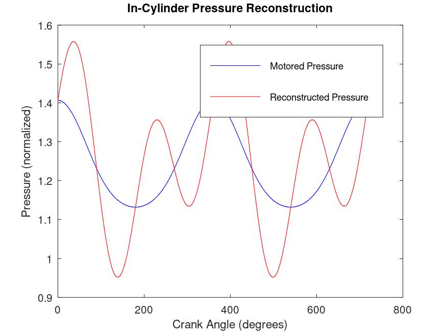
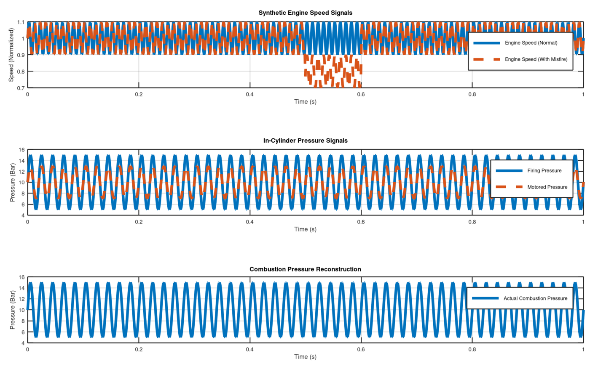

# Cylinder-pressure combustion analysis & in-cylinder pressure reconstruction

**ENGR7029 Racing Engine Systems – Thermal (Advanced Combustion Analysis) · Oxford Brookes University · November 2024 · Individual**
**Tools:** AVL IndiSet data · Excel · MATLAB

---

## The problem

Cylinder pressure is the most direct measurement of combustion, but it isn't combustion itself: volume change, heat transfer, crevice flow and blow-by all shape it too. The brief had two parts:

1. Turn measured pressure data from a fully instrumented **1.6 L GDI engine** (BMW Mini: 77 × 85.8 mm, 138.4 mm con-rod, CR 10.5) into mass fraction burned and heat release.
2. Critically review a recent paper that uses cylinder pressure, then test whether its method can be implemented.

## Part 1 — Mass fraction burned and heat release

- Mean cycle pressure at several speed and load points, with volume from the slider-crank relation:
  `V(θ) = Vd/(r−1) + Vd/2 · [R + 1 − cos θ − (R² − sin²θ)^½]`
- Start and end of combustion identified from departure from polytropic compression and expansion (pVⁿ)
- **Rassweiler–Withrow** MFB: `mb = [(pVⁿ)θ − (pVⁿ)start] / [(pVⁿ)end − (pVⁿ)start]`
- **Wiebe** fit: `mb = 1 − exp[−a((θ − θs)/Δθ)^(m+1)]`
- **Single-zone first-law heat release**, derived from first principles:
  `dQ/dθ = 1/(k−1) · V dp/dθ + k/(k−1) · p dV/dθ`

## Part 2 — Reviewing and re-implementing pressure reconstruction from crankshaft speed

**Paper reviewed:** Moro et al., *In-cylinder pressure reconstruction based on instantaneous engine speed signal* (2002).

The idea is to avoid an expensive pressure transducer in every cylinder by working out combustion pressure from the crankshaft speed signal.

- Motored pressure is modelled as polytropic (n = 1.32 compression, 1.27 expansion) from the state at intake-valve closing and mapped across the operating range. Only the **combustion pressure** term is left unknown.
- The reciprocating-mass inertia torque grows with speed² and masks the gas torque at high rpm. Removing it gives a **"synthetic" engine speed** that correlates with indicated torque.
- A frequency response function links synthetic speed to combustion pressure. Comparing a firing cycle with a misfire, `Ar · p_comb(t) · f_crank = J · Δθ̈_s(t)`, isolates the combustion contribution.

**My implementation:** I built a simplified four-cylinder model in MATLAB using piston area, crank radius and operating conditions. It generates synthetic speed signals from crankshaft dynamics and reconstructs combustion pressure for steady and transient cases.

| Motored vs reconstructed pressure | Synthetic speed and pressure reconstruction |
|---|---|
|  |  |

## Evaluation

- **Strengths:** high sensitivity to misfire and abnormal combustion, and it reuses the crank sensor every ECU already has, so it suits torque-based drive-by-wire control in both PFI and GDI engines.
- **Limits:** on a 4-cylinder engine each cylinder can only be recovered over a 180° window. With more than four cylinders the expansion strokes overlap and full recovery is much harder, which matters for V6/V8 racing engines. Accuracy also depends on mapping the motored pressure over the whole operating range.
- **Next step:** feed reconstructed pressure into a misfire and combustion-phasing estimator, and validate it against measured transducer traces from the GDI dataset.

## Skills demonstrated

Cylinder-pressure data reduction · MFB (Rassweiler–Withrow, Wiebe) · first-law heat release · critical review of research literature · MATLAB signal modelling
