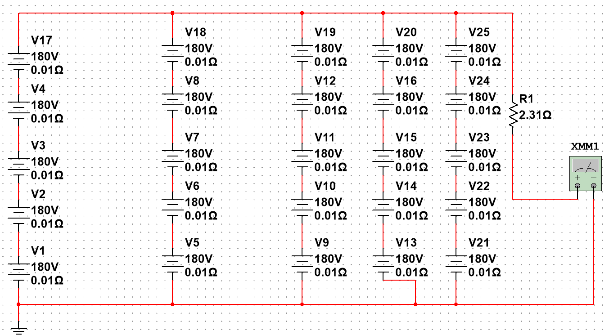
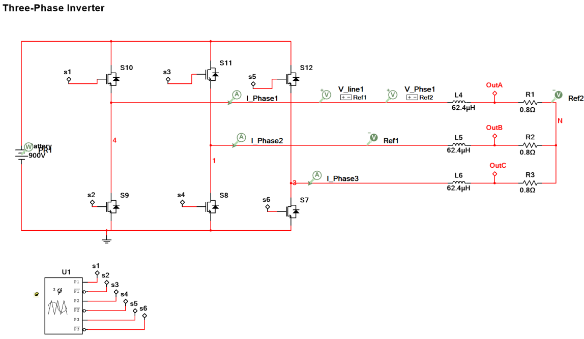
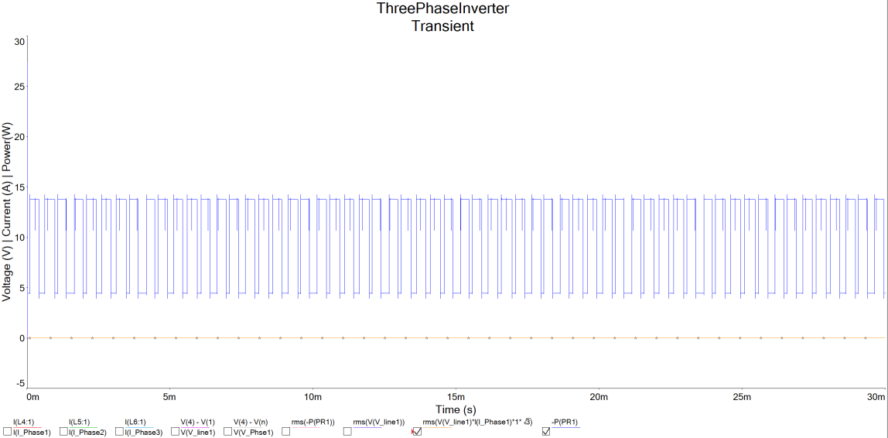
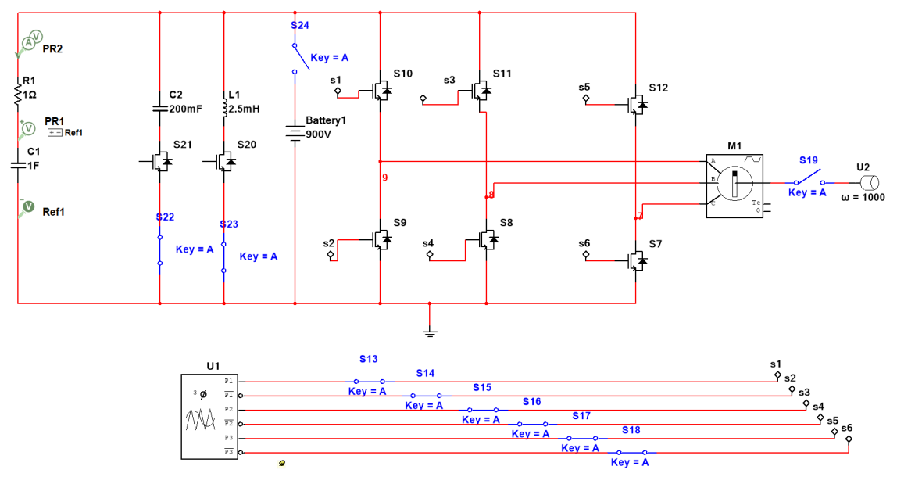
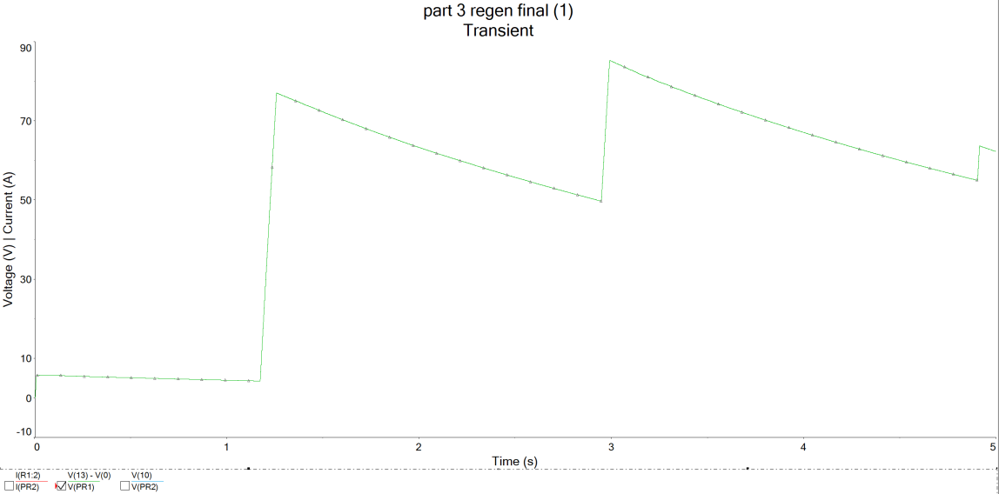

# Electric powertrain design for a Formula E Gen3-class rear motor

**ENGR7031 Electric Powertrain, Coursework 1 · Oxford Brookes University · December 2024 · Individual**
**Tools:** NI Multisim · Python (sizing check)

---

## The problem

Design the three core blocks of a high-performance electric powertrain around a **350 kW** rear motor: the high-voltage battery pack, the three-phase inverter, and a regenerative braking circuit. Justify component choices analytically and check them in circuit simulation.

**Design targets:** 350 kW peak · 900 V nominal · 50 kWh storage.

## 1 · Battery pack

| Parameter | Value |
|---|---|
| Cell | Li-ion NMC 21700, 3.7 V, 5 Ah (LG INR21700-M50T class) |
| Configuration | **243 s × 12 p**, 2,916 cells |
| Capacity / energy | 60 Ah / ≈ 54 kWh installed (≥ 50 kWh target) |
| Peak current | 389 A pack → 32.4 A per string |
| Pack resistance (10 mΩ/cell) | 0.20 Ω |
| Voltage sag at peak power | 78.8 V → **821 V under load** |

**Cell choice.** I compared the LG M50T (260 Wh/kg, 70 g) with the Tesla 4680 (≈ 300 Wh/kg, 15–20 Ah, 355 g). The 4680 would cut the number of parallel strings, but I chose the 21700 for its lighter, more flexible packaging.

`pack_sizing.py` reproduces the sizing and adds two checks the hand calculation didn't show: per-string current is within **8 %** of the cell's 35 A rating, and I²R loss at peak power is about **31 kW**. Both point towards lower-resistance cells or more parallel strings.

```bash
python pack_sizing.py
```


*Scaled 5 × 5 Multisim pack model with 10 mΩ per cell and a 2.31 Ω equivalent load: ≈ 900 V and ≈ 369 A in transient analysis.*

## 2 · Three-phase inverter

- **Device choice:** compared Si IGBT, Si MOSFET and SiC MOSFET. MOSFETs switch faster with lower losses, but bring larger voltage overshoot from parasitics and more EMI from high dv/dt. I chose an **Infineon FF600R12KE3 IGBT module** (1,200 V / 600 A, up to 20 kHz) for robustness at 900 V.
- **Model:** six-switch bridge with PWM gate drive into an RL motor-equivalent load, run as a transient analysis at 10 kHz

| Inverter schematic | Inverter output (PWM switching) |
|---|---|
|  |  |

**What the simulation showed:** clean PWM switching with small ripple filtered by the load inductance. The RL test load (0.8 Ω, 62.4 µH) has a power factor of only about 0.2 at 10 kHz, so the real-power efficiency calculated from it was low. The next step is a proper PMSM load model and a loss model for the switches. SiC MOSFETs are the clear upgrade path for efficiency and lower current THD.

## 3 · Regenerative braking

- Reverse-torque PWM on the inverter, rectifier diodes to control energy flow, a capacitor bank in parallel with the pack, and a buck-boost stage
- The transient shows the expected sawtooth voltage: a sharp rise when braking starts, then steady charging

| Regen circuit | Regen transient |
|---|---|
|  |  |

**Safety margins I applied:** regen bus voltage ≤ 80 % of nominal (720 V), 20–30 % current headroom on power electronics and storage, and ripple current < 10 % of peak.

## Next steps

Replace ideal sources with an equivalent-circuit cell model (OCV–SOC, RC pairs), add a battery/ultracapacitor split for regen peaks, and move the inverter to SiC with a switching-loss model.

## Skills demonstrated

HV battery pack sizing · power-semiconductor selection · inverter and regenerative braking circuit simulation · design margins and safety · Python engineering calculations
