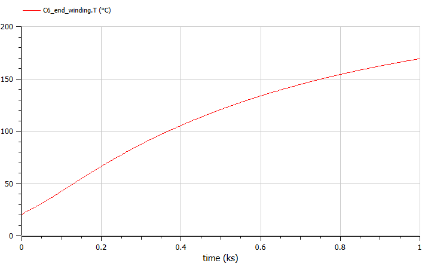
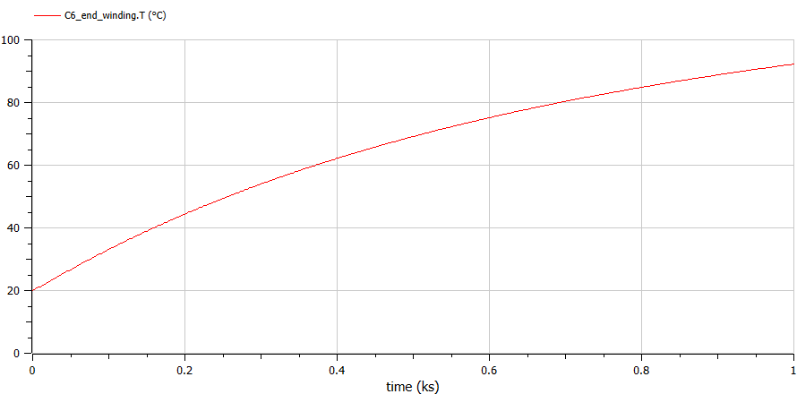
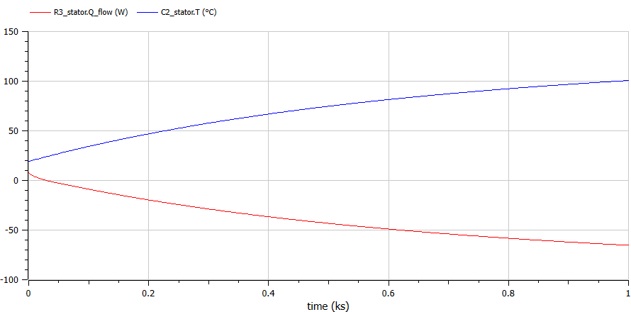
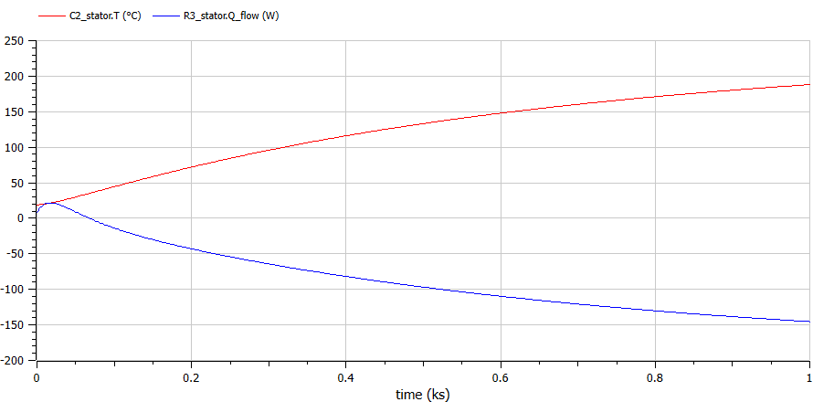

# Lumped-parameter thermal model of a hybrid traction motor with ATF cooling

**ENGR7031 Electric Powertrain Systems (Thermal) · Oxford Brookes University · December 2024 · Individual**
**Tools:** OpenModelica · Toyota Prius motor test data (ORNL) · IEC 60034-6 / IEC 60085

---

## The problem

Motor temperature limits continuous power. Winding insulation has a hard limit, and magnet and copper losses rise with temperature. Lumped-parameter thermal networks (LPTN) predict component temperatures fast enough for design iteration and real-time derating, unlike CFD or FEA. The brief: review machine thermal modelling, choose a published cooling study, and implement it in open-source software.

## Literature review (summary)

- **Heat sources:** copper (Joule) losses dominate, with iron and mechanical losses on top
- **Modelling options:** CFD for detail, FEA for conduction, and LPTN as RC networks for speed. Hybrid CFD–LPTN and LPTN–2D-analytical methods balance accuracy and run time.
- **Emerging cooling:** phase-change materials (high latent heat, but low conductivity needs metal foams or nano-additives), 3D-printed windings with integrated heat sinks, and spray cooling
- **Regulation context:** I compared the electric-drive rules for Formula E (single rear motor, spec battery) and WEC LMDh (spec 50 kW hybrid system)

## Approach

1. **Baseline LPTN.** I built a Prius traction-motor network in OpenModelica with 38 thermal resistances and 10 capacitances, calculated from motor geometry and material data, and simulated it for 1,000 s.
2. **Validated it** against ORNL Prius motor thermal tests (Marlino & Rogers, 2005). Measured winding temperatures were 156–168.5 °C across 35–105 °C coolant, against a ~170 °C winding limit. The model's end-winding temperature reached **≈ 169 °C**, in line with the measured range.
3. **Investigation:** Prius cooling across four generations (Matsumoto et al., SAE 2019-01-2312), from water jackets to direct ATF stator-coil cooling to an ATF heat exchanger with rotor-core cooling, which the paper reports cut thermal resistance by more than 50 %.
4. **Implemented 4th-gen ATF cooling** in the model:
   - ATF heat exchanger at **0.1 kg/s**, 60 °C inlet; IC71W indirect liquid cooling per IEC 60034-6
   - Stator copper loss estimated at 2–5 % of the 53 kW rating (1.06–2.65 kW), with a **1.5 kW** baseline heat flow

## Results

| Baseline end-winding temperature | End-winding temperature with ATF heat exchanger |
|---|---|
|  |  |

- End-winding temperature after 1,000 s fell from **≈ 169 °C to ≈ 92 °C** with the ATF heat exchanger, leaving a large margin to the Class H (180 °C, IEC 60085) insulation limit.
- Stator-node heat-flow and thermal-resistance outputs confirm that heat now leaves through the ATF path.

## Limitations & next steps

- Temperatures were still rising at 1,000 s, so a longer run is needed for steady state
- Average losses were used; coupling loss maps to a drive cycle (speed/torque → copper and iron loss) would give transient duty-cycle temperatures
- ATF properties were held constant; temperature-dependent viscosity and the convection coefficient should be added
- The next modelling target is a rare-earth-free machine with the same cooling architecture

## Skills demonstrated

Lumped-parameter thermal networks · OpenModelica · model validation against test data · motor cooling design · thermal and insulation standards
