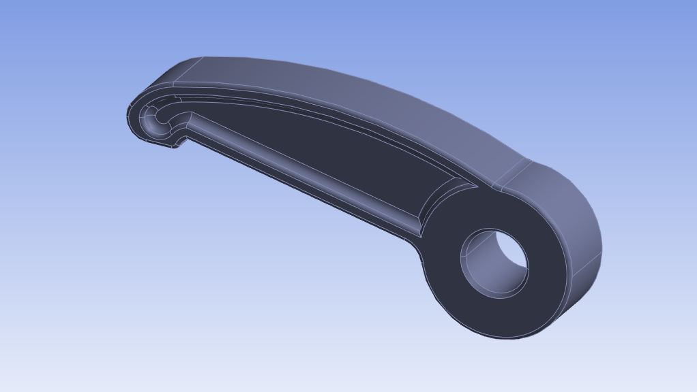
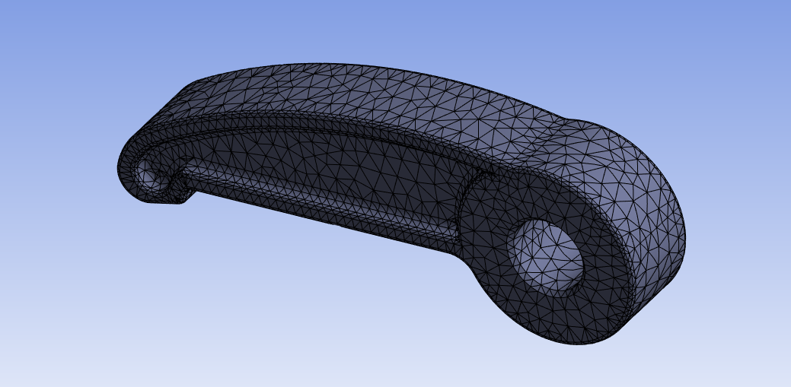
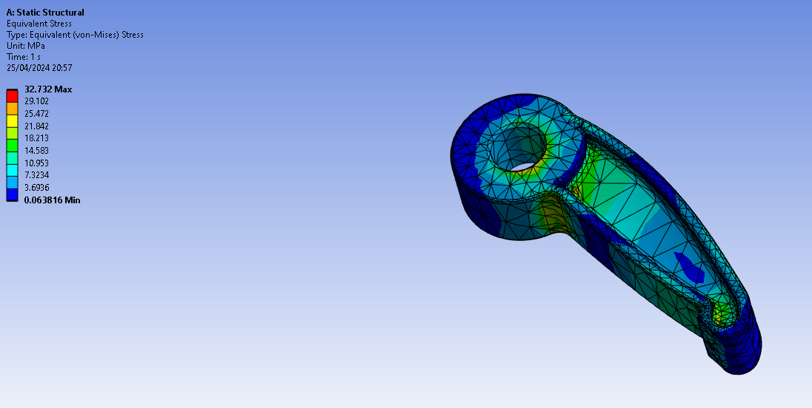
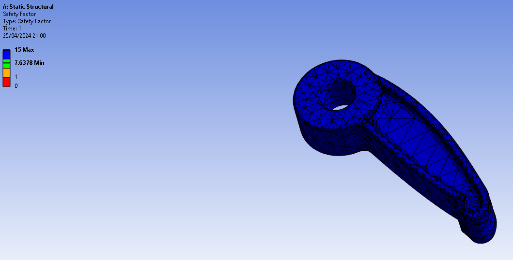
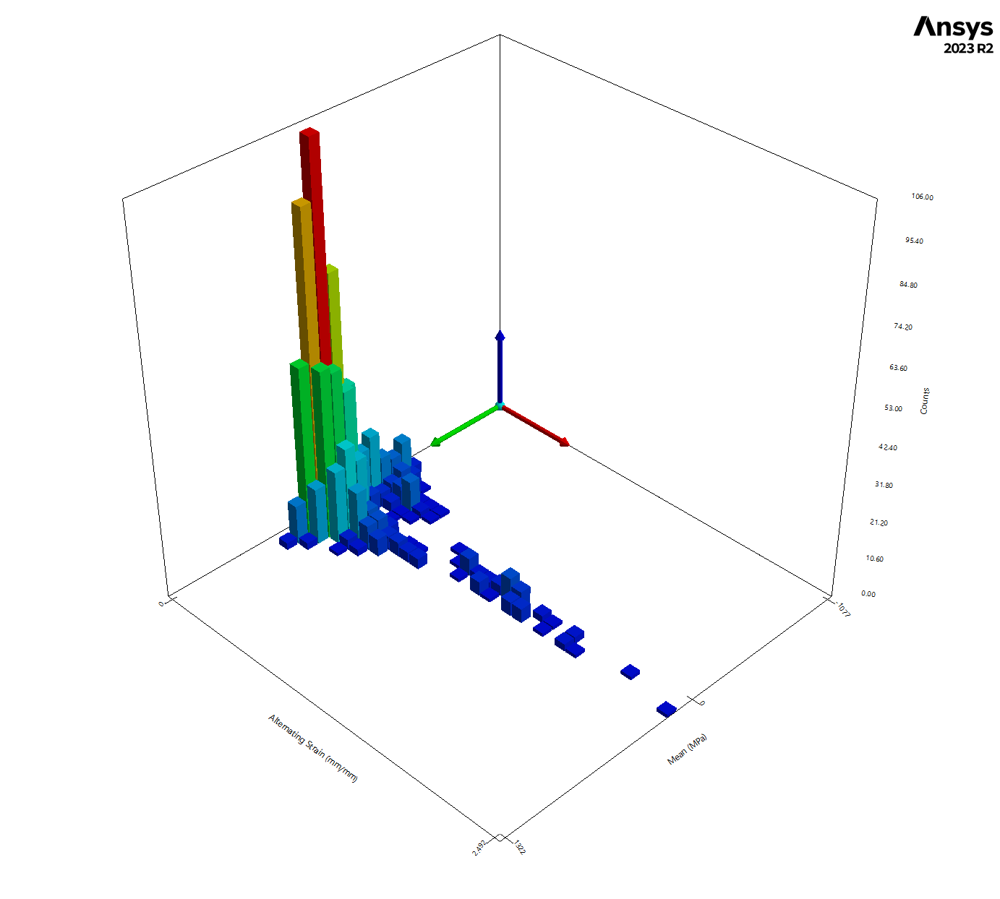
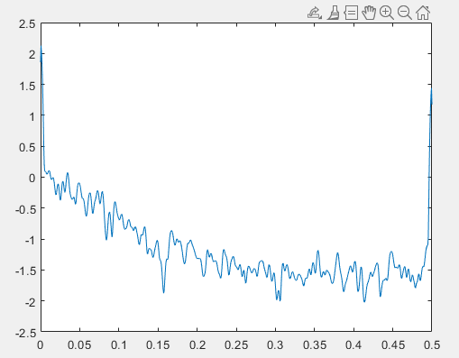

# Time- and frequency-domain fatigue of a desmodromic rocker arm under random loading

**ENGR7012 Advanced Strength of Components, mini project · Oxford Brookes University · Spring 2024 · Group of three (equal contribution)**
**Tools:** Ansys Discovery / Mechanical (static and fatigue) · MATLAB (PSD)

---

## The problem

Valvetrain parts see random, variable-amplitude loads, so constant-amplitude S-N data alone doesn't predict their life. We picked the **opening rocker arm of a desmodromic valvetrain** from a high-revving Desmo V4 motorcycle engine (86 × 42.56 mm, CR 13.5, 197 hp at 13,800 rpm) and assessed its fatigue life with both time-domain and frequency-domain methods.

A desmodromic system closes the valve with a second cam and rocker instead of a spring. That removes valve float, but the rockers carry the full inertia and cam-contact loads in both directions.

## Approach

1. **Loads and boundary conditions:** valvetrain inertia, cam contact force and dynamic response. The rocker-shaft bore was fixed, with two forces applied: cam force on opening, and closing force on the valve-side pad.
2. **CAD and FEA in Ansys.** Structural steel, with mesh refined from the 5 mm default to **1 mm**. Outputs: total deformation, von Mises stress, equivalent strain, safety factor.
3. **Time-domain fatigue:** non-constant-amplitude load history, strain-life analysis (Kf = 1) with mean-stress correction, a **rainflow matrix**, Palmgren–Miner damage summation and a hysteresis plot
4. **Frequency-domain fatigue:** power spectral density of the load in MATLAB, and statistical regeneration of an equivalent time history assuming an ergodic, stationary Gaussian process

| Rocker arm CAD | 1 mm mesh |
|---|---|
|  |  |

## Results

| Equivalent (von Mises) stress | Safety factor |
|---|---|
|  |  |

- **Peak equivalent stress: 31.2 MPa**, located around the rocker-shaft bore and neck, where published rocker-arm failures start
- **Minimum static safety factor: 7.6**
- The peak stress is the same order as published rocker-pad measurements (≈ 21 MPa at idle; Spiegelberg & Andersson, *Wear*, 2006), which supports the load assumptions

| Rainflow matrix (time domain) | Load PSD (frequency domain) |
|---|---|
|  |  |

## Discussion

- **Time vs frequency domain:** time-domain methods have richer material models (S-N, ε-N, mean-stress corrections), but rainflow results depend on the time window recorded. Spectral methods give statistically robust cycle distributions from spectral moments, but only through Basquin-type stress models.
- The same random process can give different lives depending on the sampled history, its bandwidth, stress level and record length, so life estimates should be reported with scatter rather than as a single number.

## What I'd do differently

- Use a proper valve-lift-derived load spectrum at several engine speeds instead of a generic random history
- Report spectral moments (m0, m1, m2, m4) and Dirlik damage alongside the rainflow result, so the two methods can be compared directly
- Model the chrome-coated contact surfaces and the bore fillet radius explicitly, since both control crack initiation

## Skills demonstrated

Ansys static and fatigue FEA · mesh refinement · rainflow counting and Miner's rule · PSD / spectral fatigue · valvetrain loading · group engineering project
