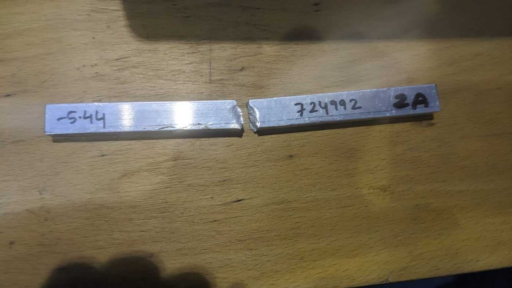
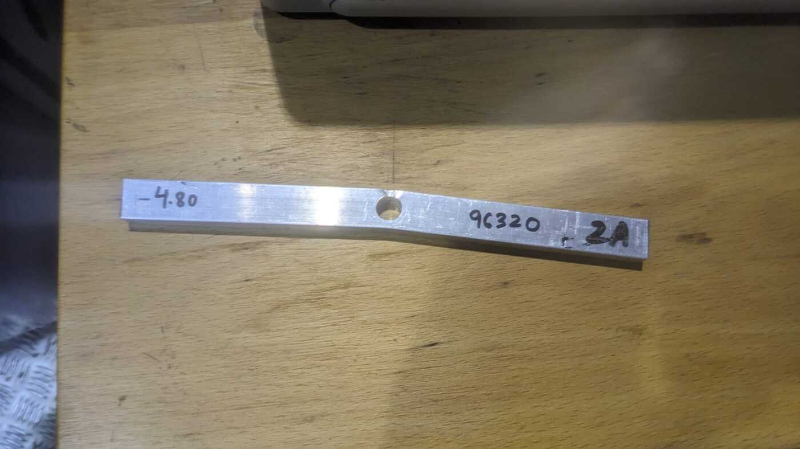

# Fatigue laboratory: S-N life prediction vs physical test

**ENGR7012 Advanced Strength of Components, fatigue laboratory · Oxford Brookes University · March 2024 · Individual report (lab tests run as a group)**
**Tools:** universal testing machine · multi-channel data logger · Python (calculation check)

---

## The problem

Predict the cyclic load at which two AA6082-T6 aluminium beams should fail in four-point bending after **10⁵ cycles**, then test them:

- a **plain beam**
- a **beam with a drilled hole** (stress concentration)

## Approach

1. **Tensile test** on a dog-bone specimen: peak load 25.87 kN → **UTS = 336 MPa**
2. **Section properties** from averaged measured width and depth (I = bd³/12), plus the mean stress from the 200 N machine pre-load
3. **Endurance-modified strengths** using Marin-type factors:
   - 10³ cycles: 0.9·Su
   - 10⁸ cycles: 0.4·Su · C_size · C_surface / K_f, with size factor 0.61·d^−0.097
   - **Goodman** mean-stress correction at both points, solved for the alternating stress
4. **Notch:** K_t = 2.12 from a polynomial fit in d/D; with notch sensitivity q = 0.9 this gives **K_f = 2.01**
5. **Basquin S-N line** `Sa = a·N^b` through the two points, evaluated at 10⁵ cycles, converted to bending moment and then to machine load (F = 4·F_a + 200 N)

`sn_prediction.py` reproduces the whole chain:

```bash
python sn_prediction.py
```

| | Plain beam | Beam with hole |
|---|---|---|
| Sa(10³) | 155.0 MPa | 155.2 MPa |
| Sa(10⁸) | 73.9 MPa | 36.9 MPa |
| S-N line | Sa = 241.8·N^−0.0644 | Sa = 367.5·N^−0.125 |
| **Predicted max load for 10⁵ cycles** | **5.5 kN** | **4.4 kN** |

## Results

| | Plain beam | Beam with hole |
|---|---|---|
| Max test load | 5.44 kN | 4.80 kN |
| Difference from predicted load | 1.1 % | 8.6 % |
| Cycles achieved | **724,992 — fractured** | **96,320 — no fracture** |

| Plain beam after test | Beam with hole after test |
|---|---|
|  |  |

**Interpretation**

- The plain beam ran close to the predicted load but lasted about **7× the predicted 10⁵ cycles**. The S-N approach with handbook Marin factors is conservative for this polished extrusion, which is normally what you want in design.
- The notched beam carried 8.6 % more than the predicted load for about 10⁵ cycles without breaking, so K_f = 2.01 (q = 0.9) probably overstates the notch effect for this hole and material.
- One specimen per condition can't separate model error from normal fatigue scatter. Several specimens at several stress levels are needed to fit a proper S-N curve.

## Skills demonstrated

Tensile and fatigue testing · S-N curve construction · Marin factors, Goodman correction, notch sensitivity · comparing predictions with test results · Python engineering calculations
